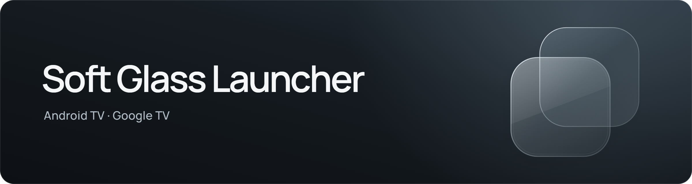
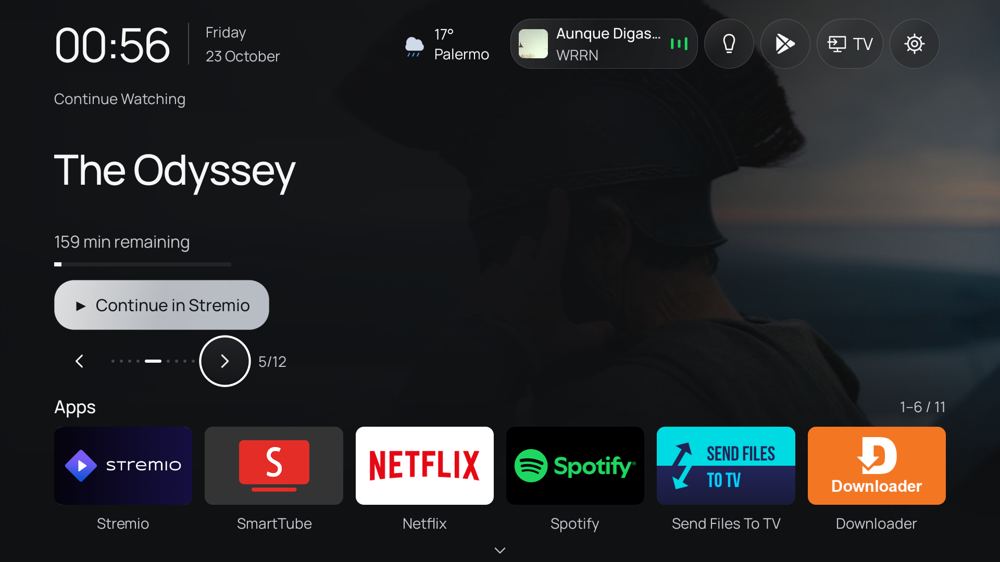
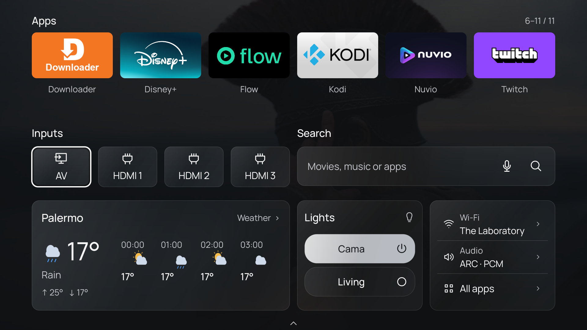

A lightweight native launcher for **Android TV and Google TV (Android 8+)**, with glass surfaces and remote-friendly navigation.

**[Download the APK](https://github.com/thomrnowtea/soft-glass-launcher/releases/latest)**

- One app slider with six visible apps. Hold OK to reorder; add or remove apps from Home.
- Light, dark and system themes, Manrope typography and reduced motion.
- Optional weather, local WiZ on/off controls, Stremio Continue Watching and a Spotify mini player.
- First-run setup for appearance, apps, city, connections and Home. Every integration is optional.

## Screenshots

Captured on a TCL Google TV. Installed apps and connections vary by setup.

### Home



### Widgets



## Install

1. Download `SoftGlassLauncher-4.0.0.apk` from [Releases](https://github.com/thomrnowtea/soft-glass-launcher/releases).
2. Sideload it onto your TV and open **Soft Glass Launcher**.
3. Follow setup. Choose it as your default Home if your TV supports that option.

Reopen setup at **Settings → Customize → Setup guide**. Some TVs restrict Home selection or automatic startup. Samsung Tizen and LG webOS cannot run this APK. Other brands and firmware still need real-device testing.

## Build

Requires **JDK 17** and **Android SDK 34**.

```sh
./gradlew :app:assembleDebug
```

On Windows, use `gradlew.bat`. The debug APK is in `app/build/outputs/apk/debug/`. Release signing is documented in [DISTRIBUTION.md](DISTRIBUTION.md).

## Connections

WiZ lights must share the TV's local network. Stremio uses your own account; Spotify playback needs optional notification access. Showing the Wi-Fi name may require Android location permission. Weather only needs a selected city. TMDB artwork enrichment uses your own optional key. No accounts or credentials are bundled in the APK.

Interactive HTML prototypes are in [design/](design/README.md).

## Credits

Based on [CleanYourTV](https://github.com/Gathin23/cleanyourtv) by Gathin. [MIT license](LICENSE); [font licenses](licenses/).
